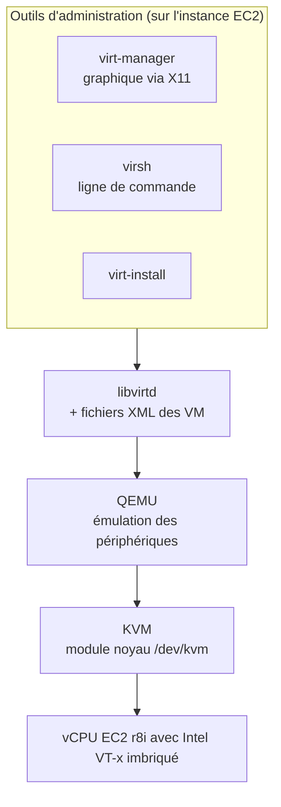
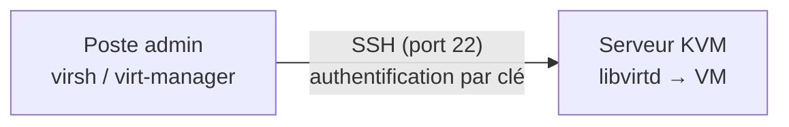
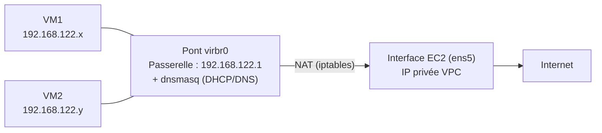

# TP : Virtualisation avec KVM, QEMU et libvirt

> **Environnement :** Instance Cloud **AWS EC2 (`r8i.large`, Ubuntu 24.04 LTS Server)** avec virtualisation imbriquée activée, administrée à distance via **SSH** (MobaXterm sur Windows, Terminal + XQuartz sur macOS, ou Terminal SSH sur Linux).  
> **Objectifs :**
> 1. Comprendre le rôle de chaque brique (KVM, QEMU, libvirt, virsh, virt-manager)
> 2. Installer et vérifier un hôte KVM sur un serveur cloud
> 3. Créer, piloter, sauvegarder et cloner une VM en ligne de commande
> 4. Manipuler les images disque (`qcow2`), les réseaux et les snapshots

---

## Avant de commencer : KVM et architecture du TP

**KVM** (*Kernel-based Virtual Machine*) est un module du noyau Linux (intégré depuis le noyau 2.6.20). Il s'appuie sur les extensions matérielles du processeur (Intel VT-x ou AMD-V) et transforme le noyau Linux en hyperviseur : on le classe généralement parmi les hyperviseurs de **type 1**, puisque c'est le noyau lui-même qui joue ce rôle _(souvent qualifié d'hybride, mais considéré comme type 1 en production car le noyau gère directement le matériel)_.

KVM ne fait pas tout seul tourner une VM : il fournit l'accélération CPU et mémoire. C'est **QEMU** qui émule le reste du matériel (disque, carte réseau, écran…). Gérer QEMU à la main reste fastidieux, d'où **libvirt** : une bibliothèque et un démon (`libvirtd`) qui offrent une interface unique pour plusieurs technologies (KVM/QEMU, Xen, LXC…). Les outils `virsh`, `virt-install` et `virt-manager` passent tous par libvirt.



| Brique | Rôle | Paquet (Ubuntu/Debian) |
|---|---|---|
| KVM | Accélération matérielle dans le noyau | intégré au noyau |
| QEMU | Émulation du matériel de la VM | `qemu-system-x86` |
| libvirt | Démon + API de gestion | `libvirt-daemon-system` |
| virsh | Client CLI de libvirt | `libvirt-clients` |
| virt-install | Création de VM en CLI | `virtinst` |
| virt-manager | Interface graphique | `virt-manager` |
| qemu-img | Gestion des images disque | `qemu-utils` |

> [!NOTE]
> **À propos des performances : VirtIO**
>
> Émuler un vrai matériel (contrôleur SATA, carte réseau Intel…) coûte cher : QEMU doit imiter chaque registre du composant réel. Pour éviter ce coût, KVM/QEMU propose des périphériques **paravirtualisés VirtIO** : le système invité sait qu'il est virtualisé et utilise une interface simplifiée, conçue pour la virtualisation.
> `virt-install` choisit VirtIO automatiquement lorsque le système invité le supporte (d'où l'importance de l'option `--osinfo`, section 5). Conséquence visible dans vos VM Linux :
> - le disque apparaît sous le nom **`/dev/vda`** (*virtio disk a*) au lieu de `/dev/sda` ;
> - la carte réseau utilise le pilote `virtio_net`.
>
> Linux intègre ces pilotes nativement ; un invité **Windows** nécessite d'installer les pilotes VirtIO séparément.


---
## 1. Prérequis : le processeur supporte-t-il la virtualisation ?

> [!NOTE]
> Ce TP suppose que votre instance EC2 est **déjà lancée avec la virtualisation imbriquée activée** et que vous êtes **connecté en SSH**. Si ce n'est pas le cas, suivez d'abord le [guide de préparation de l'instance EC2](guide-ec2.md).

### Configuration de l'hôte KVM (Instance AWS EC2 `r8i.large`)

| Ressource      | Spécification utilisée             | Rôle                                                                |
| -------------- | ---------------------------------- | ------------------------------------------------------------------- |
| **vCPU**       | 2 cœurs (avec Intel VT-x imbriqué) | Exécution des VM invitées avec accélération matérielle              |
| **RAM**        | 16 Go                              | Hébergement de l'OS hôte Ubuntu et des VM (Alpine, CirrOS)          |
| **Disque EBS** | 50 Go                              | Stockage du système, des images ISO et des disques virtuels `qcow2` |

### Vérification des extensions matérielles

- Vérifiez la présence des extensions de virtualisation dans le processeur exposé à votre instance :

```bash
grep -Ec '(vmx|svm)' /proc/cpuinfo
```

Le résultat est le nombre de processeurs (cœurs logiques) qui disposent de l'extension.  **0** signifie que la virtualisation imbriquée n'est pas active sur l'instance EC2 : vérifiez que l'option Nested Virtualization a bien été activée lors de sa création.

- Identifiez le type d'extension :

```bash
grep -Eo '(vmx|svm)' /proc/cpuinfo | sort -u
```

- `vmx` : processeur **Intel** (VT-x)
- `svm` : processeur **AMD** (AMD-V)

- Vérifiez que les modules KVM existent pour votre noyau :

```bash
find /lib/modules/$(uname -r) -iname "*kvm*"
```

Parmi les résultats, seuls trois modules nous intéressent : `kvm` (le cœur de KVM), `kvm-intel` et `kvm-amd` (la partie propre au fabricant du processeur). L'extension `.zst` indique que le module est compressé.

## 2. Installation de l'hôte KVM

```bash
sudo apt update
sudo apt install -y qemu-system-x86 qemu-utils libvirt-daemon-system libvirt-clients \
virtinst virt-manager virt-viewer bridge-utils cpu-checker
```

Activer et démarrer le démon libvirt :

```bash
sudo systemctl enable --now libvirtd
sudo systemctl status libvirtd
```

Ajouter votre utilisateur aux groupes `libvirt` et `kvm` (pour ne pas avoir à utiliser `sudo` à chaque commande) :

```bash
sudo usermod -aG libvirt,kvm $USER
```

> [!NOTE]
> L'ajout à un groupe ne prend effet qu'après une **nouvelle connexion** (déconnectez-vous / reconnectez-vous, ou lancez `newgrp libvirt`). Vérifiez avec `groups` et `groups $USER`.

### 2.1 Vérifications

```bash
kvm-ok                          # fourni par cpu-checker (Ubuntu)
lsmod | grep kvm                # les modules sont-ils chargés ?
sudo virt-host-validate qemu    # diagnostic complet de l'hôte
```

Résultat attendu pour `kvm-ok` :

```text
INFO: /dev/kvm exists
KVM acceleration can be used
```

Si les modules ne sont pas chargés : `sudo modprobe kvm_intel` (ou `sudo modprobe kvm_amd`).

### 2.2 Se connecter à l'hyperviseur

```bash
virsh -c qemu:///system list --all
```

> [!NOTE]
> libvirt propose deux connexions :
> - `qemu:///system` : VM du système, gérées par le démon root (c'est ce qu'on utilise dans ce TP, et ce que voit virt-manager par défaut)
> - `qemu:///session` : VM privées de l'utilisateur
>
> Un utilisateur non-root qui tape simplement `virsh` est connecté à `qemu:///session` et **ne verra pas** les VM du système. Pour éviter de répéter `-c qemu:///system` :
> ```bash
> echo 'export LIBVIRT_DEFAULT_URI=qemu:///system' >> ~/.bashrc
> source ~/.bashrc
> ```

`virsh` peut s'utiliser de deux façons :

```bash
virsh list --all     # commande directe depuis le shell
virsh                # mode interactif : l'invite devient "virsh #"
virsh # list --all
virsh # quit
```

- Gérer un hyperviseur distant via SSH (après échange de clés) :

```bash
virsh -c qemu+ssh://utilisateur@ip_serveur/system list --all
```



---
## 3. Le réseau des VM

### 3.1 Le réseau NAT par défaut

libvirt crée automatiquement un réseau virtuel nommé `default` : un pont `virbr0` avec un serveur DHCP et du NAT vers l'extérieur.



- **virbr0** : commutateur virtuel auquel sont branchées les VM ; il sert aussi de passerelle (`192.168.122.1`).
- **dnsmasq** : distribue les adresses IP aux VM (DHCP) et résout les noms (DNS).
- **NAT** : les VM sortent vers l'extérieur avec l'adresse de l'hôte ; elles ne sont pas joignables depuis l'extérieur.

```bash
virsh net-list --all
virsh net-info default
virsh net-dumpxml default
ip addr show virbr0
```

Si le réseau `default` est inactif :

```bash
virsh net-start default
virsh net-autostart default
```

 **Question 1.** Quelle plage d'adresses IP le réseau `default` distribue-t-il ? 


---
## 4. Les disques virtuels (fichiers images disque)

### 4.1 Les formats de disques virtuels

QEMU sait manipuler plusieurs formats de disques virtuels (souvent appelés « images disque » dans le jargon de la virtualisation, par opposition aux images système contenant déjà un OS comme les ISO) :

| Format | Origine | Particularités |
|---|---|---|
| **qcow2** | QEMU (natif) | Copy-on-write, allocation à la demande, snapshots internes, compression. **Format recommandé.** |
| raw | — | Image brute, octet pour octet. Très performante, mais sans snapshots |
| vmdk | VMware | Utile pour importer des VM VMware |
| vdi | VirtualBox | Utile pour importer des VM VirtualBox |

### 4.2 Le pool de stockage

libvirt range les disques des VM dans des **pools de stockage**. Un pool de type `dir` est simplement un répertoire de l'hôte. Sur une installation neuve, aucun pool n'existe encore :

```bash
virsh pool-list --all
```

- Créez le pool `default`, qui correspond au répertoire `/var/lib/libvirt/images` :

```bash
virsh pool-define-as default dir --target /var/lib/libvirt/images
virsh pool-start default
virsh pool-autostart default
```

- Vérifiez :

```bash
virsh pool-list --all
virsh pool-info default
virsh vol-list default
```

### 4.3 Créer et inspecter une image

`qemu-img create` crée un disque virtuel **vierge** (non partitionné et sans système d'exploitation, comme un disque dur neuf). Nous créons dès maintenant le disque de **4 Gio** qui accueillera notre VM Alpine Linux à la section 5 :

> [!NOTE] En production, `virt-install --disk size=4` peut créer ce fichier automatiquement. Nous le créons ici manuellement avant l'installation afin d'observer son allocation dynamique (_thin provisioning_).


```bash
sudo qemu-img create -f qcow2 /var/lib/libvirt/images/alpine1.qcow2 4G
sudo qemu-img info /var/lib/libvirt/images/alpine1.qcow2
ls -lh /var/lib/libvirt/images/alpine1.qcow2
du -h  /var/lib/libvirt/images/alpine1.qcow2
```

- Actualisez le pool de stockage pour que libvirt indexe ce nouveau volume :

```bash
virsh pool-refresh default
virsh vol-list default
```

**Question 2.** Comparez la *virtual size* donnée par `qemu-img info` et la place réellement occupée (`du -h`). Que pouvez-vous en déduire sur le format qcow2 ?

---
## 5. Créer une VM avec virt-install

Nous installons **Alpine Linux** (édition *virt*) : une distribution très légère, dont l'ISO se télécharge et s'installe en quelques minutes.

### 5.1 Télécharger l'ISO en ligne de commande

Téléchargez directement l'ISO **x86_64 « Virtual »** dans le répertoire `/var/lib/libvirt/boot` :

```bash
sudo mkdir -p /var/lib/libvirt/boot
ALPINE_ISO=$(curl -s https://dl-cdn.alpinelinux.org/alpine/latest-stable/releases/x86_64/ | grep -oE 'alpine-virt-[0-9.]+-x86_64\.iso' | head -n 1)
sudo wget -O /var/lib/libvirt/boot/alpine.iso "https://dl-cdn.alpinelinux.org/alpine/latest-stable/releases/x86_64/${ALPINE_ISO}"
ls -lh /var/lib/libvirt/boot/alpine.iso
```
### 5.2 Lancer la création de la VM

```bash
virt-install \
  --name alpine1 \
  --memory 1024 \
  --vcpus 1 \
  --cpu host-passthrough \
  --disk path=/var/lib/libvirt/images/alpine1.qcow2,format=qcow2 \
  --cdrom /var/lib/libvirt/boot/alpine.iso \
  --osinfo detect=on,require=off \
  --network network=default \
  --graphics none \
  --console pty,target_type=serial
```

|**Option**|**Rôle**|
|---|---|
|`--name`|Nom de la VM (domaine libvirt)|
|`--memory`|Mémoire en Mio|
|`--vcpus`|Nombre de processeurs virtuels|
|`--cpu host-passthrough`|Expose à l'invité le modèle exact du CPU de l'hôte (meilleures performances)|
|`--disk path=...,format=qcow2`|Attache le disque virtuel de 4 Gio créé à la section 4.3|
|`--cdrom`|Média d'installation|
|`--osinfo detect=on,require=off`|Détecte automatiquement l'OS depuis l'ISO pour activer les pilotes VirtIO|
|`--network network=default`|Réseau NAT de libvirt (`bridge=br0` pour un pont)|
|`--graphics none`|Pas d'affichage graphique (sinon `spice` ou `vnc`)|
|`--console pty,target_type=serial`|Console texte de la VM (port série), affichée dans le terminal|

La console de la VM s'affiche directement dans votre terminal :

- pour la **quitter** sans arrêter la VM : **Ctrl + ]** (sur clavier AZERTY : **Ctrl + AltGr + )** ou **Ctrl + $** ; en dernier recours depuis un second terminal SSH : `pkill -f "virsh console"`) ;
    
- pour y **revenir** : `virsh console alpine1` (puis Entrée).
    

> [!WARNING]
> 
> Lancez `virt-install` **une seule fois**. Si la commande échoue, supprimez la définition de la VM avant de recommencer : `virsh destroy alpine1`, puis `virsh undefine alpine1` (ajoutez `--remove-all-storage` uniquement si vous souhaitez aussi supprimer le disque et le recréer).

### 5.3 Installer Alpine

Dans la console :

1. La VM démarre sur l'ISO : si l'invite `boot:` s'affiche, tapez `virt` puis Entrée ; sur un CPU rapide (comme EC2), le démarrage passe directement à `localhost login:`.
    
2. Connectez-vous en `root` (pas de mot de passe).
    
3. Lancez `setup-alpine` et répondez aux questions : clavier `fr` (`fr`), hostname `alpine1`, réseau `eth0` en `dhcp`, mot de passe root, fuseau horaire, valeurs par défaut pour proxy/miroir/SSH, puis disque **`vda`** en mode **`sys`**.
    
4. Une fois l'installation terminée : `reboot`. La VM redémarre sur son disque ; connectez-vous en `root` avec le mot de passe choisi.
    

### 5.4 Vérifier la connectivité

Dans la VM (`alpine1:~#`) :

```bash
ip addr
ping -c 3 192.168.122.1     # passerelle (virbr0)
ping -c 3 8.8.8.8           # Internet via le NAT

```

Quittez la console (**Ctrl + ]**) pour revenir sur l'hôte Ubuntu EC2, puis récupérez l'adresse IP de la VM :

```bash
virsh domifaddr alpine1
```

**Question 3.** Pingez la VM depuis l'hôte EC2. Fonctionne-t-il ? Est-ce qu'une autre instance EC2 (ou votre PC personnel) pourrait joindre directement cette VM ? Pourquoi ?

---
## 6. Piloter les VM avec virsh

| Action                                | Commande                                         |
| ------------------------------------- | ------------------------------------------------ |
| VM actives                            | `virsh list`                                     |
| VM inactives                          | `virsh list --inactive`                          |
| Toutes les VM                         | `virsh list --all`                               |
| Démarrer                              | `virsh start alpine1`                            |
| Arrêt propre (ACPI)                   | `virsh shutdown alpine1`                         |
| Arrêt forcé (« débrancher la prise ») | `virsh destroy alpine1`                          |
| Redémarrer                            | `virsh reboot alpine1`                           |
| Mettre en pause / reprendre           | `virsh suspend alpine1` / `virsh resume alpine1` |
| Démarrage automatique avec l'hôte     | `virsh autostart alpine1`                        |
| Infos sur la VM                       | `virsh dominfo alpine1`                          |
| Disques de la VM                      | `virsh domblklist alpine1`                       |
| Interfaces réseau                     | `virsh domiflist alpine1`                        |
| Infos sur l'hôte                      | `virsh nodeinfo`                                 |

> [!NOTE]
> `virsh destroy` **ne supprime pas** la VM : il la coupe brutalement, comme si on arrachait la prise. Pour supprimer une VM, c'est `virsh undefine`.

**Question 4.** Mettez la VM en pause avec `virsh suspend alpine1`, puis observez son état (`virsh list`) et sa console (`virsh console alpine1`, puis **Ctrl + ]**). Quelle différence avec un `shutdown` ? *(Pensez à exécuter `virsh resume alpine1` ensuite.)*

---
## 7. La configuration XML

libvirt décrit chaque VM dans un fichier XML (matériel, disques, réseau, périphériques).

- Affichez la configuration :

```bash
virsh dumpxml alpine1
```

- Inspectez uniquement les ressources matérielles (mémoire, CPU, disque) :

```bash
virsh dumpxml alpine1 | grep -E "memory|vcpu|source file"
```

> [!NOTE] Ne modifiez jamais directement les fichiers de `/etc/libvirt/qemu/` : libvirt ne relirait pas vos changements. Pour modifier une VM existante, on passe par `virsh edit alpine1` (qui valide le XML à l'enregistrement) ou par des commandes dédiées (`virsh setmem`, `virsh setvcpus`). La plupart des changements ne s'appliquent qu'au **prochain démarrage**.
---

## 8. Snapshots

Un snapshot fige l'état de la VM pour pouvoir y revenir. Il nécessite un disque **qcow2**.

```bash
virsh snapshot-create-as alpine1 propre --description "Après installation"
virsh snapshot-list alpine1
```

**Exercice.**
1. Dans la VM, créez un fichier : `echo "test" > /root/fichier.txt`
2. Éteignez la VM, puis restaurez le snapshot : `virsh snapshot-revert alpine1 propre`
3. Redémarrez la VM : le fichier existe-t-il encore ?
4. Supprimez le snapshot : `virsh snapshot-delete alpine1 propre`

## 9. Cloner et importer une VM (images cloud)


### 9.1 Cloner une VM avec virt-clone

Plutôt que de réinstaller un système complet, on clone une VM existante (éteinte) :

```bash
virsh shutdown alpine1
virt-clone --original alpine1 --name alpine2 --auto-clone

```

- `virt-clone` copie automatiquement le disque virtuel et génère un nouveau fichier XML en modifiant les **4 éléments uniques** d'une VM : son nom (`<name>`), son identifiant (`<uuid>`), le chemin de son disque (`<source file=...>`) et l'adresse MAC de sa carte réseau (`<mac address=.../>`, pour éviter tout conflit sur `virbr0`).
    
- Vérifiez la différence entre les deux configurations XML :

```bash
diff -u <(virsh dumpxml alpine1) <(virsh dumpxml alpine2) | grep -E "^[-+]\s*<(name|uuid|source file|mac address)"
```
### 9.2 Importer une image cloud prête à l'emploi

`virt-install --import` crée une VM à partir d'un disque **déjà installé**, sans ISO ni étape d'installation. C'est le principe utilisé par les clouds (comme AWS EC2 ou OpenStack) à partir d'images préconfigurées.

Téléchargez et inspectez **CirrOS**, un mini-système Linux conçu pour tester les clouds :

```bash
wget https://download.cirros-cloud.net/0.6.3/cirros-0.6.3-x86_64-disk.img
qemu-img info cirros-0.6.3-x86_64-disk.img
sudo mv cirros-0.6.3-x86_64-disk.img /var/lib/libvirt/images/cirros1.qcow2

```
- Démarrez directement la VM à partir de ce disque :

```bash
virt-install --import \
  --name cirros1 \
  --memory 256 --vcpus 1 \
  --disk /var/lib/libvirt/images/cirros1.qcow2,format=qcow2 \
  --osinfo detect=on,require=off \
  --network network=default \
  --graphics none \
  --console pty,target_type=serial

```
> [!NOTE] Au démarrage, CirrOS cherche un **service de métadonnées cloud** (`169.254.169.254` — celui-là même utilisé par votre instance EC2) pour récupérer sa configuration (hostname, clés SSH…). Comme ce service est absent sur notre réseau virtuel local, patientez ~20 secondes jusqu'à l'invite `login:`. Connexion : utilisateur `cirros`, mot de passe `gocubsgo`. Pour quitter la console : **Ctrl + ]**.
## 10. virt-manager et QEMU sans libvirt

**virt-manager** fournit une interface graphique au-dessus de libvirt : création de VM, console, statistiques CPU/RAM en temps réel, snapshots et migration entre hôtes.

### 10.1. Afficher virt-manager avec MobaXterm

1. Ouvrez **MobaXterm** et créez une session SSH vers votre instance EC2 (**Session → SSH**, adresse IP publique de l'instance, utilisateur `ubuntu`, puis onglet **Advanced SSH settings → Use private key** pour sélectionner votre fichier `.pem`).
2. Vérifiez en haut à droite de la fenêtre MobaXterm que l'icône **X server** est active (le transfert X11 est activé par défaut). *(Sous macOS/Linux, connectez-vous depuis un terminal avec `ssh -Y -i votre-cle.pem ubuntu@<IP_EC2>`.)*
3. Lancez `virt-manager` en arrière-plan depuis l'instance EC2 :

```bash
virt-manager &
```

4. Agrandissez la fenêtre qui s'ouvre sur votre écran Windows et **double-cliquez sur `QEMU/KVM`** pour déplier la liste des VM (`alpine1`, `alpine2`, `cirros1`). Double-cliquez sur une VM pour afficher sa console graphique et ses courbes CPU/mémoire.
    

**Question 5.** Les VM créées en ligne de commande apparaissent-elles dans `virt-manager` ? Qu'est-ce que cela montre sur le rôle de `libvirt` ?

### 10.2. QEMU sans libvirt

On peut lancer QEMU directement sans passer par `libvirt`. Créez un disque de test personnel, puis démarrez QEMU sur l'ISO Alpine :

```bash
qemu-img create -f qcow2 ~/qemu-test.qcow2 2G

qemu-system-x86_64 -enable-kvm -m 512 \
  -drive file=$HOME/qemu-test.qcow2,format=qcow2 \
  -cdrom /var/lib/libvirt/boot/alpine.iso -boot d \
  -nographic
```

Si l'invite `boot:` s'affiche, tapez `virt`. Pour quitter QEMU : **Ctrl + A**, puis **X**.

Dans un **second onglet SSH MobaXterm** sur l'instance EC2, pendant que cette VM tourne :

```bash
virsh list --all
ps aux | grep qemu-system
```
**Question 6.** La VM lancée avec QEMU seul apparaît-elle dans `virsh list --all` (ou dans `virt-manager`) ? Quels avantages `libvirt` apporte-t-il par rapport à QEMU seul ?