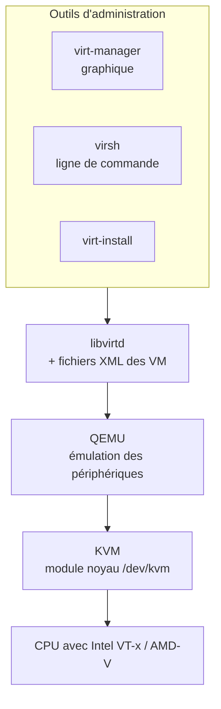
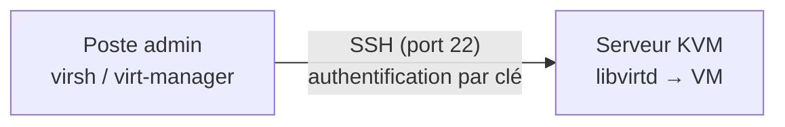
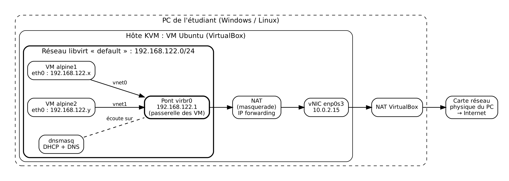

# TP : Virtualisation avec KVM, QEMU et libvirt

> **Environnement :** Ubuntu 24.04 ou 26.04 LTS Desktop, dans une VM (VirtualBox ou VMware) avec virtualisation imbriquée, ou sur un PC Linux  
> **Objectifs :**
> 1. Comprendre le rôle de chaque brique (KVM, QEMU, libvirt, virsh, virt-manager)
> 2. Installer et vérifier un hôte KVM
> 3. Créer, piloter, sauvegarder et cloner une VM en ligne de commande
> 4. Manipuler les images disque (qcow2), les réseaux et les snapshots

---

## Avant de commencer :  KVM 

**KVM** (*Kernel-based Virtual Machine*) est un module du noyau Linux (intégré depuis le noyau 2.6.20). Il s'appuie sur les extensions matérielles du processeur (Intel VT-x ou AMD-V) et transforme le noyau Linux en hyperviseur : on le classe généralement parmi les hyperviseurs de **type 1**, puisque c'est le noyau lui-même qui joue ce rôle _(souvent qualifié d'hybride, mais considéré comme type 1 en production car le noyau gère directement le matériel)_.

KVM ne fait pas tout seul tourner une VM : il fournit l'accélération CPU et mémoire. C'est **QEMU** qui émule le reste du matériel (disque, carte réseau, écran…). Gérer QEMU à la main reste fastidieux, d'où **libvirt** : une bibliothèque et un démon (`libvirtd`) qui offrent une interface unique pour plusieurs technologies (KVM/QEMU, Xen, LXC…). Les outils `virsh`, `virt-install` et `virt-manager` passent tous par libvirt.



| Brique | Rôle | Paquet (Ubuntu/Debian) |
|---|---|---|
| KVM | Accélération matérielle dans le noyau | intégré au noyau |
| QEMU | Émulation du matériel de la VM | `qemu-system-x86` |
| libvirt | Démon + API de gestion | `libvirt-daemon-system` |
| virsh | Client CLI de libvirt | `libvirt-clients` |
| virt-install | Création de VM en CLI | `virtinst` |
| virt-manager | Interface graphique | `virt-manager` |
| qemu-img | Gestion des images disque | `qemu-utils` |

> [!NOTE]
> **À propos des performances : VirtIO**
>
> Émuler un vrai matériel (contrôleur SATA, carte réseau Intel…) coûte cher : QEMU doit imiter chaque registre du composant réel. Pour éviter ce coût, KVM/QEMU propose des périphériques **paravirtualisés VirtIO** : le système invité sait qu'il est virtualisé et utilise une interface simplifiée, conçue pour la virtualisation.
> `virt-install` choisit VirtIO automatiquement lorsque le système invité le supporte (d'où l'importance de l'option `--osinfo`, section 5). Conséquence visible dans vos VM Linux :
> - le disque apparaît sous le nom **`/dev/vda`** (*virtio disk a*) au lieu de `/dev/sda` ;
> - la carte réseau utilise le pilote `virtio_net`.
>
> Linux intègre ces pilotes nativement ; un invité **Windows** nécessite d'installer les pilotes VirtIO séparément.


---

## 1. Prérequis : le processeur supporte-t-il la virtualisation ?


### Configuration recommandée

| | Hôte KVM (PC Linux ou VM Ubuntu) | PC physique (si l'hôte KVM est une VM) |
|---|---|---|
| CPU | 2 cœurs min., 4 recommandés | VT-x / AMD-V activé dans le BIOS |
| RAM | 4 Go min., 6 Go recommandés | 8 Go min. |
| Disque libre | 10 Go (15–20 Go pour être à l'aise) | taille de la VM Ubuntu + 10 Go |

> [!IMPORTANT]
> **Vous travaillez dans une VM (VirtualBox ou VMware) ?** Il faut activer la **virtualisation imbriquée**, sinon KVM ne fonctionnera pas dans la VM. La VM doit être **éteinte** (pas « Sauvegarder l'état »).
>
> **VirtualBox :** *Configuration* → *Système* → onglet *Processeur* → cocher **« Activer VT-x/AMD-V imbriqué »** et attribuer **2 à 4 processeurs** (jamais tous ceux du PC). Si la case est grisée, depuis un terminal du PC (sous Windows : `cmd`, dans `C:\Program Files\Oracle\VirtualBox`) :
> ```
> VBoxManage modifyvm "NomDeLaVM" --nested-hw-virt on
> ```
>
> **VMware :** *Settings* → *Processors* → cocher **« Virtualize Intel VT-x/EPT or AMD-V/RVI »**.

> [!WARNING]
> **PC sous Windows :** si Hyper-V, WSL2 ou la « sécurité basée sur la virtualisation » sont actifs, VirtualBox et VMware ne peuvent généralement pas fournir la virtualisation imbriquée (VirtualBox affiche alors une **tortue verte** en bas de la fenêtre de la VM et fonctionne en mode très lent). Il faut désactiver ces fonctionnalités Windows, puis redémarrer le PC.

- Vérifiez la présence des extensions de virtualisation :

```bash
grep -Ec '(vmx|svm)' /proc/cpuinfo
```

Le résultat est le nombre de processeurs (cœurs logiques) qui disposent de l'extension. **0** signifie que la virtualisation matérielle n'est pas disponible : vérifier le BIOS du PC, ou l'option de virtualisation imbriquée de la VM.

> [!TIP]
> **Le résultat est 0 dans une VM VirtualBox ?**
> 1. Éteignez complètement la VM, puis vérifiez que l'option est bien active : `VBoxManage showvminfo "NomDeLaVM"` doit afficher `Nested VT-x/AMD-V: enabled`.
> 2. Une **tortue verte** en bas de la fenêtre de la VM signifie que VirtualBox fonctionne au-dessus de Hyper-V : voir l'avertissement ci-dessus.

- Identifiez le type d'extension :

```bash
grep -Eo '(vmx|svm)' /proc/cpuinfo | sort -u
```

- `vmx` : processeur **Intel** (VT-x)
- `svm` : processeur **AMD** (AMD-V)

Vérifiez que les modules KVM existent pour votre noyau :

```bash
find /lib/modules/$(uname -r) -iname "*kvm*"
```

Parmi les résultats, seuls trois modules nous intéressent : `kvm` (le cœur de KVM), `kvm-intel` et `kvm-amd` (la partie propre au fabricant du processeur). L'extension `.zst` indique que le module est compressé.

**Question 1.** La commande `find` liste à la fois `kvm-intel` et `kvm-amd`. Lequel des deux votre machine utilisera-t-elle ? Justifiez avec la sortie de la commande `grep -Eo`.


---
## 2. Installation de l'hôte KVM

```bash
sudo apt update
sudo apt install -y qemu-system-x86 qemu-utils libvirt-daemon-system libvirt-clients \
virtinst virt-manager virt-viewer bridge-utils cpu-checker
```

Activer et démarrer le démon libvirt :

```bash
sudo systemctl enable --now libvirtd
sudo systemctl status libvirtd
```

Ajouter votre utilisateur aux groupes `libvirt` et `kvm` (pour ne pas avoir à utiliser `sudo` à chaque commande) :

```bash
sudo usermod -aG libvirt,kvm $USER
```

> [!NOTE]
> L'ajout à un groupe ne prend effet qu'après une **nouvelle connexion** (déconnectez-vous / reconnectez-vous, ou lancez `newgrp libvirt`). Vérifiez avec `groups` et `groups $USER`.

### 2.1 Vérifications

```bash
kvm-ok                          # fourni par cpu-checker (Ubuntu)
lsmod | grep kvm                # les modules sont-ils chargés ?
sudo virt-host-validate qemu    # diagnostic complet de l'hôte
```

Résultat attendu pour `kvm-ok` :

```text
INFO: /dev/kvm exists
KVM acceleration can be used
```

Si les modules ne sont pas chargés : `sudo modprobe kvm_intel` (ou `sudo modprobe kvm_amd`).

### 2.2 Se connecter à l'hyperviseur

```bash
virsh -c qemu:///system list --all
```

> [!NOTE]
> libvirt propose deux connexions :
> - `qemu:///system` : VM du système, gérées par le démon root (c'est ce qu'on utilise dans ce TP, et ce que voit virt-manager par défaut)
> - `qemu:///session` : VM privées de l'utilisateur
>
> Un utilisateur non-root qui tape simplement `virsh` est connecté à `qemu:///session` et **ne verra pas** les VM du système. Pour éviter de répéter `-c qemu:///system` :
> ```bash
> echo 'export LIBVIRT_DEFAULT_URI=qemu:///system' >> ~/.bashrc
> source ~/.bashrc
> ```

`virsh` peut s'utiliser de deux façons :

```bash
virsh list --all     # commande directe depuis le shell
virsh                # mode interactif : l'invite devient "virsh #"
virsh # list --all
virsh # quit
```

- Gérer un hyperviseur distant via SSH (après échange de clés) :

```bash
virsh -c qemu+ssh://utilisateur@ip_serveur/system list --all
```



---

## 3. Le réseau des VM

### 3.1 Le réseau NAT par défaut


libvirt crée automatiquement un réseau virtuel nommé `default` : un pont `virbr0` avec un serveur DHCP et du NAT vers l'extérieur.



- **virbr0** : commutateur virtuel auquel sont branchées les VM ; il sert aussi de passerelle (`192.168.122.1`).
- **dnsmasq** : distribue les adresses IP aux VM (DHCP) et résout les noms (DNS).
- **NAT** : les VM sortent vers l'extérieur avec l'adresse de l'hôte ; elles ne sont pas joignables depuis l'extérieur.

```bash
virsh net-list --all
virsh net-info default
virsh net-dumpxml default
ip addr show virbr0
```

Si le réseau `default` est inactif :

```bash
virsh net-start default
virsh net-autostart default
```

 **Question 2.** Quelle plage d'adresses IP le réseau `default` distribue-t-il ? 


---

## 4. Les images disque

### 4.1 Les formats

QEMU sait manipuler plusieurs formats d'images disque :

| Format | Origine | Particularités |
|---|---|---|
| **qcow2** | QEMU (natif) | Copy-on-write, allocation à la demande, snapshots internes, compression. **Format recommandé.** |
| raw | — | Image brute, octet pour octet. Très performante, mais sans snapshots |
| vmdk | VMware | Utile pour importer des VM VMware |
| vdi | VirtualBox | Utile pour importer des VM VirtualBox |

### 4.2 Le pool de stockage

libvirt range les disques des VM dans des **pools de stockage**. Un pool de type `dir` est simplement un répertoire de l'hôte. Sur une installation neuve, aucun pool n'existe encore :

```bash
virsh pool-list --all
```

Créez le pool `default`, qui correspond au répertoire `/var/lib/libvirt/images` :

```bash
virsh pool-define-as default dir --target /var/lib/libvirt/images
virsh pool-start default
virsh pool-autostart default
```

Vérifiez :

```bash
virsh pool-list --all
virsh pool-info default
virsh vol-list default
```

### 4.3 Créer et inspecter une image

```bash
sudo qemu-img create -f qcow2 /var/lib/libvirt/images/test.qcow2 10G
sudo qemu-img info /var/lib/libvirt/images/test.qcow2
ls -lh /var/lib/libvirt/images/test.qcow2
du -h  /var/lib/libvirt/images/test.qcow2
```
**Question 3.** Comparez la *virtual size* donnée par `qemu-img info` et la place réellement occupée (`du -h`). Que pouvez-vous en déduire sur le format qcow2 ?

---

## 5. Créer une VM avec virt-install

Nous installons **Alpine Linux** (édition *virt*) : une distribution très légère, dont l'ISO se télécharge et s'installe en quelques minutes.

### 5.1 Récupérer l'ISO

Téléchargez l'ISO **x86_64 « Virtual »** depuis https://alpinelinux.org/downloads/ puis placez-la dans le répertoire des ISO :

```bash
sudo mkdir -p /var/lib/libvirt/boot
sudo mv alpine-*-x86_64.iso /var/lib/libvirt/boot/alpine.iso
```

### 5.2 Trouver l'identifiant du système invité

`virt-install` adapte le matériel virtuel au système invité. Cherchez l'identifiant correspondant :

```bash
virt-install --osinfo list | grep -i alpine
```

### 5.3 Lancer la création

Remplacez `alpinelinux3.21` par la valeur la plus récente trouvée à l'étape 5.2 (en cas de doute : `--osinfo linux2022`).

> [!NOTE]
> Si la version exacte de votre ISO n'apparaît pas dans `virt-install --osinfo list`, choisissez la version la plus récente proposée : les réglages matériels (VirtIO…) sont identiques.

```bash
virt-install \
  --name alpine1 \
  --memory 1024 \
  --vcpus 1 \
  --cpu host-passthrough \
  --disk size=4,format=qcow2 \
  --cdrom /var/lib/libvirt/boot/alpine.iso \
  --osinfo alpinelinux3.21 \
  --network network=default \
  --graphics none \
  --console pty,target_type=serial
```

| Option | Rôle |
|---|---|
| `--name` | Nom de la VM (domaine libvirt) |
| `--memory` | Mémoire en Mio |
| `--vcpus` | Nombre de processeurs virtuels |
| `--cpu host-passthrough` | Expose à l'invité le modèle exact du CPU de l'hôte (meilleures performances) |
| `--disk size=4,format=qcow2` | Crée un disque de 4 Gio dans le pool `default` |
| `--cdrom` | Média d'installation |
| `--osinfo` | Système invité (alias : `--os-variant`) |
| `--network network=default` | Réseau NAT de libvirt (`bridge=br0` pour un pont) |
| `--graphics none` | Pas d'affichage graphique (sinon `spice` ou `vnc`) |
| `--console pty,target_type=serial` | Console texte de la VM (port série), affichée dans le terminal |

La console de la VM s'affiche directement dans votre terminal :

- pour la **quitter** sans arrêter la VM : **Ctrl + ]** ;
- pour y **revenir** : `virsh console alpine1` (puis Entrée).

> [!NOTE]
> Une console série est plus légère et plus fiable qu'une fenêtre graphique, surtout en virtualisation imbriquée. Avec `--graphics spice`, la console s'ouvre dans **virt-viewer** (`virt-viewer alpine1`) ; pour libérer la souris capturée par la VM : **Ctrl + Alt**.

> [!WARNING]
> Lancez `virt-install` **une seule fois**. Si la commande échoue, supprimez la VM avant de recommencer : `virsh destroy alpine1`, puis `virsh undefine alpine1 --remove-all-storage`.

### 5.4 Installer Alpine

Dans la console :

1. À l'invite `boot:`, tapez `virt` puis Entrée. Le démarrage peut prendre une à deux minutes en virtualisation imbriquée.
2. Connectez-vous en `root` (pas de mot de passe).
3. Lancez `setup-alpine` et répondez aux questions : clavier `fr`, réseau `eth0` en `dhcp`, mot de passe root, fuseau horaire, puis disque `vda` en mode `sys`.
4. Une fois l'installation terminée : `reboot`. La VM redémarre sur son disque ; connectez-vous en `root` avec le mot de passe choisi.

### 5.5 Vérifier la connectivité

Dans la VM :

```bash
ip addr
ping -c 3 192.168.122.1     # passerelle (virbr0)
ping -c 3 8.8.8.8           # Internet via le NAT
```

Depuis l'hôte :

```bash
virsh domifaddr alpine1
virsh net-dhcp-leases default
```

**Question 4.** Pingez la VM depuis l'hôte. Fonctionne-t-il ? Est-ce qu'une autre machine de la salle pourrait joindre cette VM ? Pourquoi ?

---

## 6. Piloter les VM avec virsh

| Action | Commande |
|---|---|
| VM actives | `virsh list` |
| VM inactives | `virsh list --inactive` |
| Toutes les VM | `virsh list --all` |
| Démarrer | `virsh start alpine1` |
| Arrêt propre (ACPI) | `virsh shutdown alpine1` |
| Arrêt forcé (« débrancher la prise ») | `virsh destroy alpine1` |
| Redémarrer | `virsh reboot alpine1` |
| Mettre en pause / reprendre | `virsh suspend alpine1` / `virsh resume alpine1` |
| Démarrage automatique avec l'hôte | `virsh autostart alpine1` |
| Infos sur la VM | `virsh dominfo alpine1` |
| Disques de la VM | `virsh domblklist alpine1` |
| Interfaces réseau | `virsh domiflist alpine1` |
| Infos sur l'hôte | `virsh nodeinfo` |

> [!NOTE]
> `virsh destroy` **ne supprime pas** la VM : il la coupe brutalement, comme si on arrachait la prise. Pour supprimer une VM, c'est `virsh undefine`.

**Question 5.** Mettez la VM en pause avec `suspend`, puis observez son état (`virsh list`) et la console. Quelle différence avec un `shutdown` ?

---

## 7. La configuration XML

libvirt décrit chaque VM dans un fichier XML (matériel, disques, réseau, périphériques).

Afficher la configuration :

```bash
virsh dumpxml alpine1
```

La modifier proprement (libvirt valide le XML à l'enregistrement) :

```bash
virsh edit alpine1
```

> [!NOTE]
> Ne modifiez jamais directement les fichiers de `/etc/libvirt/qemu/` : libvirt ne relirait pas vos changements. Passez toujours par `virsh edit`. La plupart des changements ne s'appliquent qu'au **prochain démarrage** de la VM.

**Exercice.** VM éteinte, passez la mémoire de `alpine1` à 512 Mio et ajoutez un second vCPU avec `virsh edit` (balises `<memory>`, `<currentMemory>` et `<vcpu>`). Démarrez la VM et vérifiez avec `virsh dominfo`.

> On peut aussi utiliser les commandes dédiées : `virsh setmaxmem`, `virsh setmem`, `virsh setvcpus`.

---

## 8. Snapshots

Un snapshot fige l'état de la VM pour pouvoir y revenir. Il nécessite un disque **qcow2**.

```bash
virsh snapshot-create-as alpine1 propre --description "Après installation"
virsh snapshot-list alpine1
```

**Exercice.**
1. Dans la VM, créez un fichier : `echo "test" > /root/fichier.txt`
2. Éteignez la VM, puis restaurez le snapshot : `virsh snapshot-revert alpine1 propre`
3. Redémarrez la VM : le fichier existe-t-il encore ?
4. Supprimez le snapshot : `virsh snapshot-delete alpine1 propre`

---

## 9. Cloner et créer une VM à partir d'un XML

### 9.1 Méthode manuelle : dumpxml + define

1. Exporter la configuration (VM éteinte) :
   ```bash
   virsh shutdown alpine1
   virsh dumpxml alpine1 > ~/alpine2.xml
   ```
2. Copier le disque :
   ```bash
   sudo cp /var/lib/libvirt/images/alpine1.qcow2 /var/lib/libvirt/images/alpine2.qcow2
   ```
3. Dans `~/alpine2.xml` :
   - changer `<name>` en `alpine2`
   - **supprimer** la ligne `<uuid>` (libvirt en générera une)
   - changer le chemin du disque (`<source file=...>`) vers `alpine2.qcow2`
   - **supprimer** la ligne `<mac address=.../>` (sinon conflit réseau avec alpine1)
4. Enregistrer la VM :
   ```bash
   virsh define ~/alpine2.xml
   virsh start alpine2
   ```

**Question 6.** Quelle est la différence entre `virsh define fichier.xml` et `virsh create fichier.xml` ? (Indice : testez `create`, puis éteignez la VM et regardez `virsh list --all`.)

### 9.2 Méthode automatique : virt-clone

```bash
virt-clone --original alpine1 --name alpine3 --auto-clone
```

`virt-clone` fait automatiquement tout le travail de la section 9.1 (nouveau nom, UUID, adresse MAC et copie du disque).

### 9.3 Importer un disque existant

`virt-install --import` crée une VM à partir d'un disque **déjà installé**, sans passer par une ISO ni par une installation. C'est ainsi que fonctionnent les clouds (AWS, OpenStack) : on démarre des VM à partir d'**images prêtes à l'emploi**.

Exemple avec **CirrOS**, un mini-système Linux conçu pour tester les hyperviseurs et les clouds.

Télécharger et inspecter l'image :

```bash
wget https://download.cirros-cloud.net/0.6.3/cirros-0.6.3-x86_64-disk.img
qemu-img info cirros-0.6.3-x86_64-disk.img
```

Copier l'image dans le pool de stockage :

```bash
sudo cp cirros-0.6.3-x86_64-disk.img /var/lib/libvirt/images/cirros1.qcow2
```

Créer un petit disque de configuration au format **NoCloud** :

```bash
sudo apt install -y cloud-image-utils
echo "instance-id: cirros1" > meta-data
echo "#cloud-config" > user-data
cloud-localds seed.iso user-data meta-data
sudo cp seed.iso /var/lib/libvirt/boot/cirros1-seed.iso
```

Créer la VM :

```bash
virt-install --import \
  --name cirros1 \
  --memory 256 --vcpus 1 \
  --disk /var/lib/libvirt/images/cirros1.qcow2,format=qcow2 \
  --disk /var/lib/libvirt/boot/cirros1-seed.iso,device=cdrom \
  --osinfo linux2022 \
  --network network=default \
  --graphics none \
  --console pty,target_type=serial
```

Connexion : utilisateur `cirros`, mot de passe `gocubsgo`. Pour quitter la console : **Ctrl + ]**.

> [!NOTE]
> **Pourquoi ce disque `seed.iso` ?** Au démarrage, une image cloud cherche sa configuration (nom d'hôte, clés SSH…) auprès d'une **source de données** : en général le **service de métadonnées** du cloud (`169.254.169.254`), absent ici. CirrOS (via son outil `cirros-init`, équivalent léger de **cloud-init**) cherche d'abord une source locale au format **NoCloud** : le disque `seed.iso`. Sans lui, il ferait 20 tentatives réseau avant d'afficher `login:`.

**Question 7.**
a) Quel est le format de l'image téléchargée d'après `qemu-img info` ? Quelle est sa taille virtuelle et sa taille réelle ?
b) Pourquoi n'a-t-on eu besoin ni de `--cdrom` ni d'installation ?
c) Quel est le rôle du service de métadonnées dans un cloud ?

### 9.4 Supprimer une VM

```bash
virsh destroy alpine3                              # si elle tourne
virsh undefine alpine3 --remove-all-storage       # supprime la VM ET son disque
```

---

## 10. (Aller plus loin) virt-manager et QEMU sans libvirt

**virt-manager** fournit une interface graphique au-dessus de libvirt : création de VM, console, statistiques, snapshots, migration entre hôtes. Lancez `virt-manager` et retrouvez-y les VM créées en ligne de commande.

**Question 8.** Les VM créées avec `virsh` apparaissent-elles dans virt-manager ? Qu'est-ce que cela montre sur le rôle de libvirt ?

**QEMU sans libvirt.** On peut lancer QEMU directement. La VM n'est alors pas connue de libvirt. Créez un disque de test personnel, puis démarrez QEMU sur l'ISO Alpine :

```bash
qemu-img create -f qcow2 ~/qemu-test.qcow2 2G

qemu-system-x86_64 -enable-kvm -m 512 \
  -drive file=$HOME/qemu-test.qcow2,format=qcow2 \
  -cdrom /var/lib/libvirt/boot/alpine.iso -boot d \
  -nographic
```

À l'invite `boot:`, tapez `virt`. Pour quitter QEMU : **Ctrl + A**, puis **X**.

Dans un **second terminal**, pendant que la VM tourne :

```bash
virsh list --all
ps aux | grep qemu-system
```

**Question 9.** La VM lancée avec QEMU apparaît-elle dans `virsh list --all` ? Quels avantages libvirt apporte-t-il par rapport à QEMU seul ?

---

## Récapitulatif des commandes

| Thème | Commandes |
|---|---|
| Vérification de l'hôte | `grep -Ec '(vmx\|svm)' /proc/cpuinfo`, `kvm-ok`, `virt-host-validate` |
| Réseaux | `virsh net-list`, `net-start`, `net-autostart`, `net-dhcp-leases` |
| Stockage | `virsh pool-list`, `vol-list`, `qemu-img create / info / convert` |
| Création | `virt-install`, `virsh define`, `virsh create`, `virt-clone` |
| Cycle de vie | `start`, `shutdown`, `destroy`, `reboot`, `suspend`, `resume`, `autostart` |
| Configuration | `dumpxml`, `edit`, `dominfo`, `domifaddr` |
| Snapshots | `snapshot-create-as`, `snapshot-list`, `snapshot-revert`, `snapshot-delete` |
| Suppression | `undefine --remove-all-storage` |
